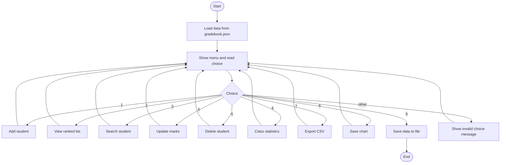
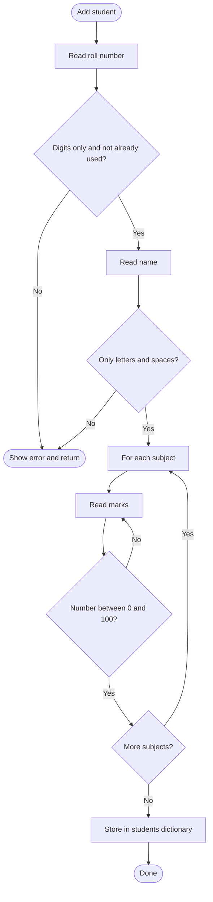
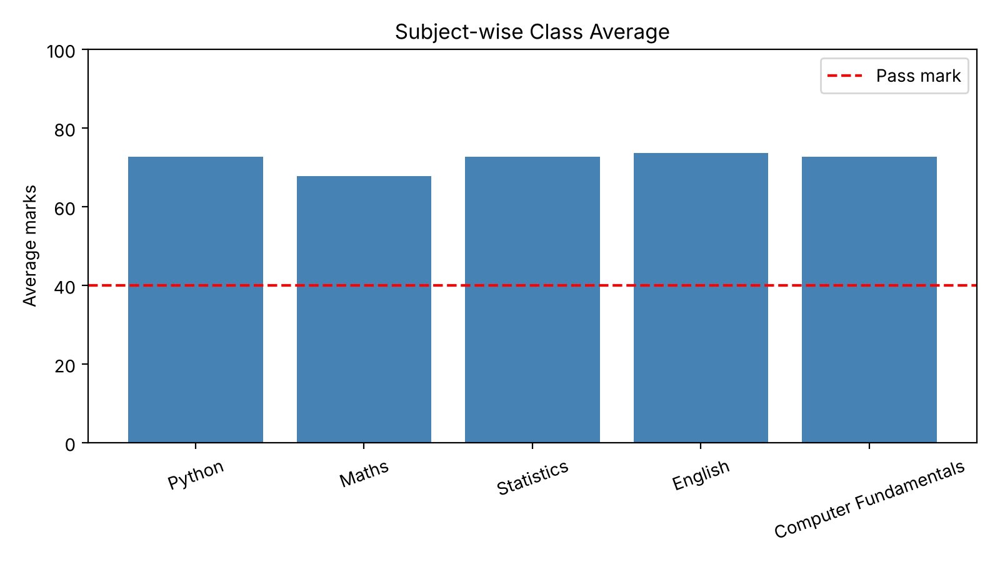

# Student Grade Book

A console-based grade management system written in Python.
Made for the Real World (RW) Python Project Session, BCA (Data Science), 1st Semester.

**Problem:** 02 – Student Grade Book (Education domain), Python Flowchart Workbook
**Level:** 2 – Moderate (dictionaries, functions, `try / except`, comprehensions)

---

## 1. Problem statement

Teachers calculate totals, averages and grades by hand for every student, and the
class report has to be prepared again whenever one mark changes. This is slow and
mistakes happen easily.

This project stores marks for each student, calculates everything automatically
and gives the teacher a ranked list, class statistics and a report that can be
opened in Excel.

## 2. Features

| # | Feature | Description |
|---|---------|-------------|
| 1 | Add student | Roll number and name are validated, marks must be 0–100 |
| 2 | Ranked list | Students sorted by total marks, ties get the same rank |
| 3 | Search | Full marksheet of one student, subjects below pass mark are flagged |
| 4 | Update marks | Change the mark of one subject |
| 5 | Delete student | Asks for confirmation before deleting |
| 6 | Class statistics | Mean, median, standard deviation, topper, pass percentage, subject-wise report, grade chart |
| 7 | Export | Saves the full report as `grade_report.csv` |
| 8 | Chart | Saves a bar chart of subject averages (needs matplotlib) |
| 9 | Save and exit | Data is stored in `gradebook.json` and loaded again next time |

### Rules used for grading

- Subjects: Python, Maths, Statistics, English, Computer Fundamentals (100 marks each)
- Grade is decided by the **average** marks: A+ (90+), A (80+), B (70+), C (60+), D (50+), F (below 50)
- Result is **PASS** only if the student scores at least **40 in every subject**.
  So a student can have grade D and still FAIL if one subject is below 40.

## 3. Program flow



Flow of adding a student:



## 4. Data structure

All students are kept in one dictionary. The roll number is the key.

```python
students = {
    "101": {
        "name": "Asha Nair",
        "marks": {"Python": 82.0, "Maths": 74.0, "Statistics": 88.0,
                  "English": 79.0, "Computer Fundamentals": 85.0}
    },
    "102": { ... }
}
```

A dictionary was chosen because searching by roll number is direct
(`students["101"]`) and there is no need to loop through a list.

## 5. Python concepts used

| Concept | Where it is used |
|---------|------------------|
| Variables and data types | constants such as `PASS_MARK`, `SUBJECTS`, `GRADE_SCALE` |
| `if / elif / else` | validation, result, menu |
| `for` and `while` loops | menu loop, asking marks until valid, ranking |
| Functions with return values | `calculate_grade()`, `get_result()`, `rank_students()` ... |
| Lists, dictionaries, tuples | `students` dict, `SUBJECTS` list, `GRADE_SCALE` list of tuples |
| `try / except` | wrong number input, missing file, damaged JSON file, only one student for std. deviation |
| Comprehensions | `all(m >= PASS_MARK for m in ...)`, list of failed students |
| `lambda` and `sort` | sorting students by total marks |
| Dictionary of functions | the menu calls `actions[choice](students)` |
| String methods and formatting | `strip()`, `title()`, `isdigit()`, `isalpha()`, `format()` |
| File handling | JSON for storage, CSV for the report |
| Modules | `json`, `csv`, `statistics`, `matplotlib` (optional) |
| Unit testing | `unittest` in `test_gradebook.py` |

## 6. How the code is organised

```
gradebook.py         main program
test_gradebook.py    12 unit tests
gradebook.json       demo data with 8 students
README.md            this file
.gitignore
```

Inside `gradebook.py` the code is divided into five parts:

1. **Data handling** – `load_data`, `save_data`
2. **Calculations** – `calculate_grade`, `get_result`, `rank_students`, `class_summary`, ...
   These functions only take values and return values (no `input` or `print`), so they are easy to test.
3. **Input helpers** – `ask_marks`, `ask_roll`
4. **Menu options** – `add_student`, `view_all`, `search_student`, ...
5. **Main program** – `main()`

## 7. How to run

Python 3.8 or above is needed.

```
python gradebook.py
```

The program opens with the demo data. To start with an empty grade book,
delete `gradebook.json` first.

For the chart option install matplotlib once:

```
pip install matplotlib
```

Everything else works without any extra library.

### Run the tests

```
python -m unittest test_gradebook -v
```

## 8. Sample output

**View all students (option 2)**

```
Rank  Roll   Name                 Total     Avg  Grade  Result
--------------------------------------------------------------
1     105    Fatima Sheikh        452.0   90.40     A+    PASS
2     102    Ravi Kumar           441.0   88.20      A    PASS
3     101    Asha Nair            408.0   81.60      A    PASS
4     107    Sneha Pillai         389.0   77.80      B    PASS
5     104    Kiran Reddy          343.0   68.60      C    PASS
6     108    Rohan Das            322.0   64.40      C    PASS
7     106    Arjun Menon          280.0   56.00      D    FAIL
8     103    Meena Joseph         240.0   48.00      F    PASS
```

**Class statistics (option 6)**

```
Number of students :  8
Class mean         :  71.88
Class median       :  73.20
Standard deviation :  15.25
Topper             :  Fatima Sheikh (90.40)
Lowest             :  Meena Joseph (48.00)
Passed             :  7 of 8 (87.5%)

Subject-wise report
Subject                   Average  Highest   Lowest
---------------------------------------------------
Python                      72.62     95.0     48.0
Maths                       67.75     90.0     35.0
Statistics                  72.75     94.0     55.0
English                     73.62     89.0     52.0
Computer Fundamentals       72.62     92.0     40.0
```

**Chart (option 8)**



## 9. Testing

12 unit tests check the grade boundaries, pass/fail rule, name validation, ranking
with ties, class statistics (including an empty class and a single student) and
saving/loading the file including a missing or damaged file.

Manual testing was also done with wrong inputs: letters in place of marks,
marks above 100, duplicate roll numbers, names with digits and invalid menu choices.
The program shows a message each time and does not crash.

## 10. Limitations and future scope

- Subjects and the pass mark are fixed inside the code. They could be read from a settings file.
- It is a console program. A GUI (Tkinter) or web version (Flask) could be built.
- Only one semester is supported. Multiple semesters and CGPA could be added.
- Level 3 version: convert it to classes (`Student`, `GradeBook`) and use inheritance for different course types.
- Use pandas for deeper analysis of the marks.

## 11. Team

| Name | Roll no. | Contribution |
|------|----------|--------------|
|      |          |              |
|      |          |              |
|      |          |              |

Christ Academy – BCA (Data Science), Semester 1
